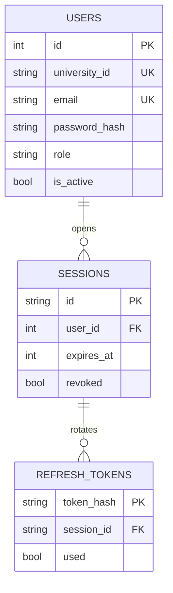
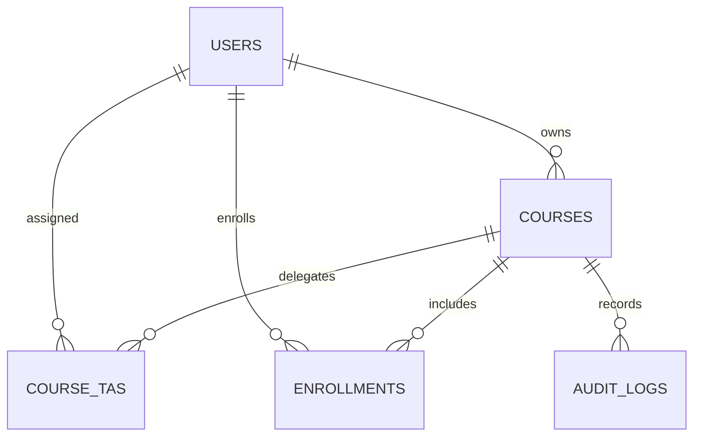
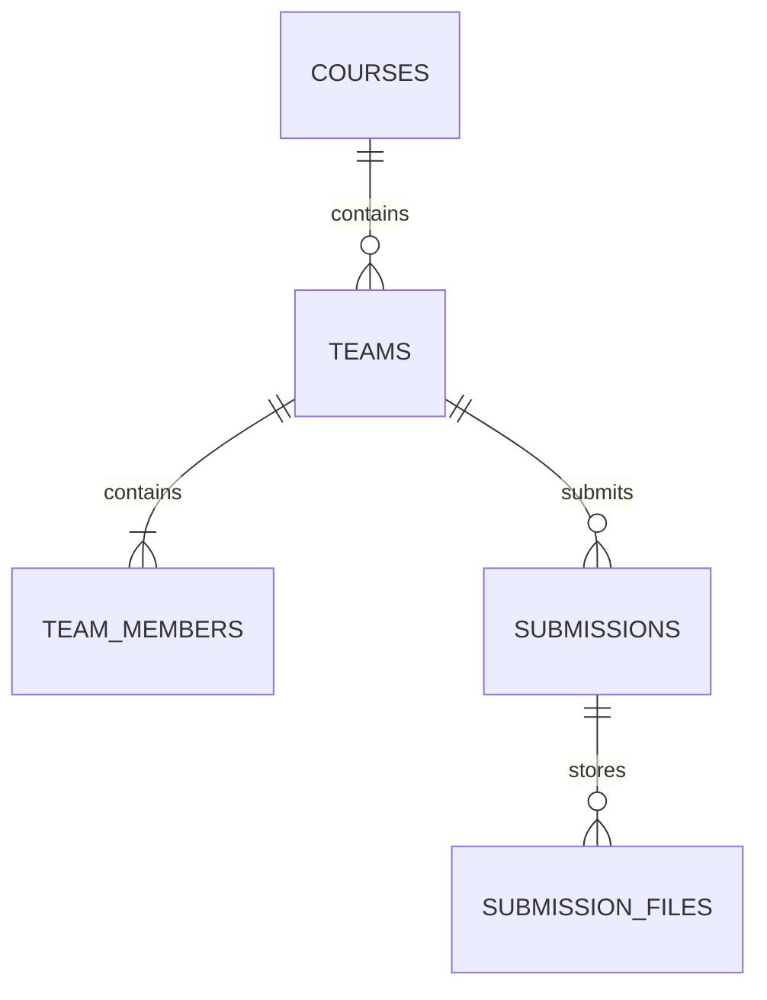
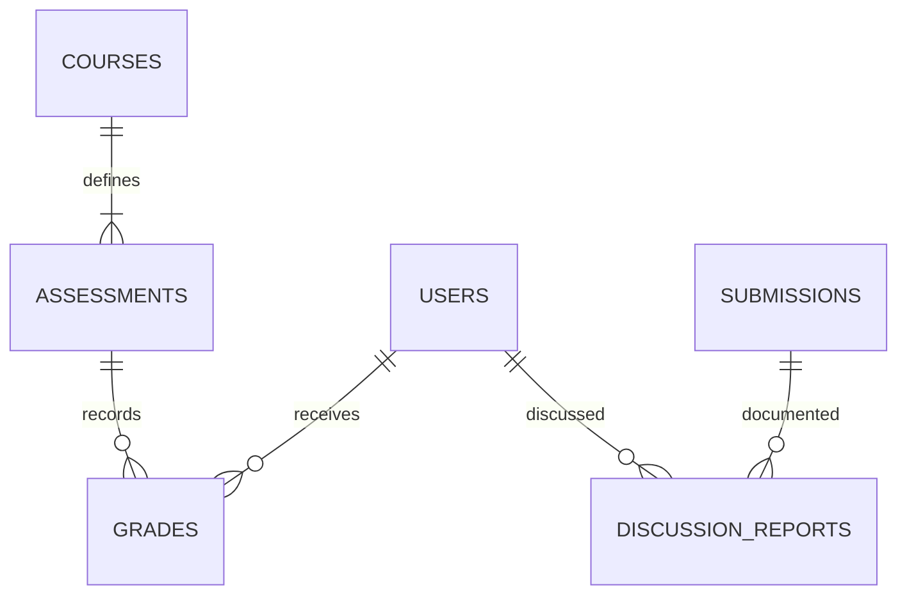

# قاعدة بيانات المرحلة الأولى

هذه رسومات لنطاق النسخة الحالية، وليست ERD لكل مراحل الـAI المستقبلية. يوجد 14 جدولًا بالإضافة لجدول Alembic الداخلي. الدور ثابت في `users.role` بثلاث قيم، بدل جدول Roles إضافي لا يحتاجه المشروع الآن.

## الحسابات والجلسات

## المقررات والأدوار داخلها

`course_tas` يخزن `can_manage_grades` و`can_view_reports` لكل معيد ومادة. `enrollments` يخزن `can_create_team`؛ هذا إذن داخل مادة، وليس دورًا عالميًا جديدًا. مالك المادة وحده ينشر درجاتها.

## الفرق والتسليم

المفتاح الأساسي في `team_members` هو `(course_id, student_id)` لمنع الفريقين في مادة واحدة. يوجد مفتاح أجنبي مركب إلى `enrollments` يؤكد التسجيل، وآخر إلى `(teams.id, teams.course_id)` يؤكد أن الفريق في نفس المادة. `teams.leader_id` يشير إلى مستخدم، والخدمة تضيف القائد عضوًا عند الإنشاء وتسمح بنقل القيادة لعضو موجود فقط.

هذه المرحلة توفر مسودة واحدة ثم نسخة نهائية واحدة. وجود `version` يجهز التوسع، لكنه لا يعني أن إعادة التسليم أو إعادة فتح القفل منفذتان.

## التقييم والتقرير

`discussion_reports` مرتبط أيضًا بالفريق، ويخزن الأسئلة والأجوبة المنظمة في JSON. التقرير لكل طالب، وإصداراته مستقلة وغير قابلة للتعديل. الدرجة من نوع Project لا تُنشر إلا مع تقرير مكتمل لذلك الطالب. تصحيح التقرير ينشئ إصدارًا جديدًا ويعيد الدرجة لانتظار النشر.

## القيود والمعاملات

| القاعدة | مكان تطبيقها |
|---|---|
| البريد والرقم الجامعي غير مكررين | UNIQUE في users |
| كود المادة والفصل غير مكررين | UNIQUE في courses |
| تسجيل الطالب ومعيد المادة مرة واحدة | مفاتيح مركبة |
| فريق واحد لكل طالب في كل مادة | PK في team_members |
| الكود السري لكل فريق فريد | UNIQUE في teams |
| نوع التقييم مرة واحدة لكل مادة | UNIQUE في assessments |
| درجة واحدة لكل طالب وتقييم | UNIQUE في grades |
| نسخة تقرير فريدة لكل فريق وطالب | UNIQUE في discussion_reports |
| الدرجة داخل الحد الأقصى للتقييم | تحقق في الخدمة داخل معاملة |
| عدم تخطي سعة الفريق | قفل صف course ثم العد والإضافة في نفس المعاملة |
| عدم تعديل ملفات أو أعضاء بعد القفل | تحقق في الخدمات تحت قفل المادة |
| تسجيل التغيير مع العملية | audit_logs داخل نفس معاملة الحفظ |

فهارس موجودة على مفاتيح العلاقات وSHA-256، والقيود الفريدة تنشئ فهارسها الخاصة. المواعيد العامة UTC؛ `sessions.expires_at` و`users.locked_until` قيم Unix seconds. لا يوجد pgvector أو embeddings أو بيانات وجه وصوت في هذه المرحلة.

`schema_postgresql.sql` نسخة DDL مرجعية ناتجة عن migration نفسها. في التشغيل استخدم `alembic upgrade head`؛ لا تشغل SQL المرجعي ثم Alembic على نفس القاعدة.
